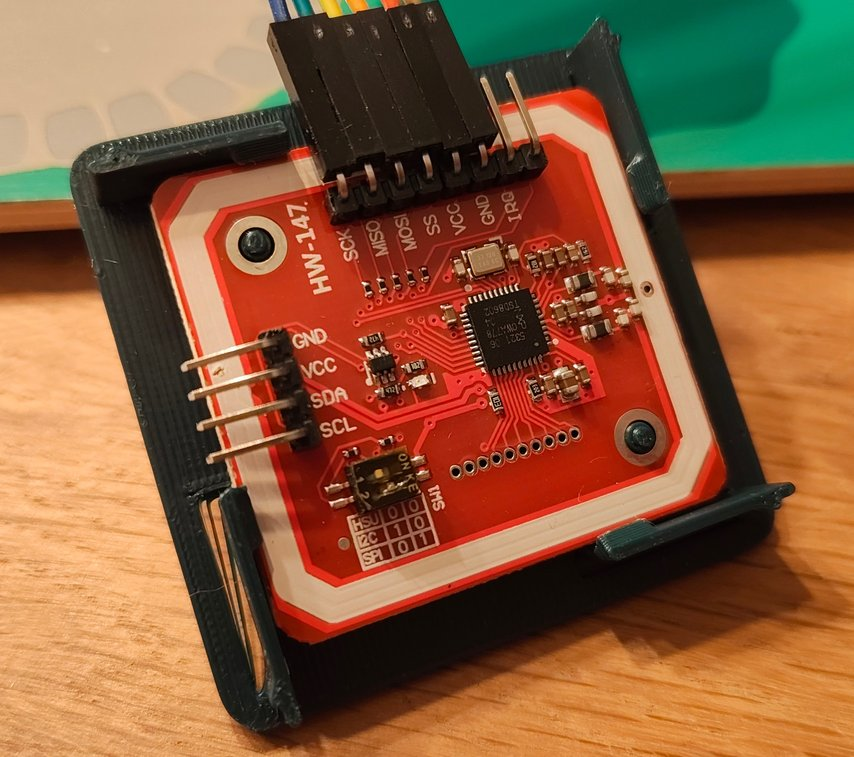
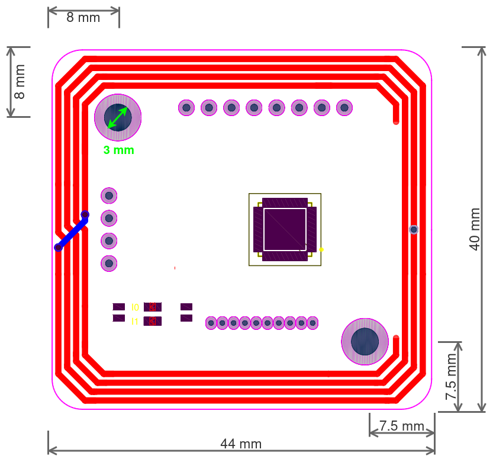

# PN532 RFID reader

The PN532 RFID reader is mounted inside the radio (at the side, where the cards or tags can be scanned). The [printed holder](holder.jpg) keeps the board in place and is glued to the radio housing. The holder has snap fingers on all sides, while two pegs locate the board in its mounting holes.

## Files

| File | What it is |
|---|---|
| `schema.drawio` | Editable electrical schematic and board dimensions. |
| `schema.drawio.png` | Rendered schematic and board dimensions. |
| `assembled_board.jpg` | Photo of the reader board in the holder. |
| `holder.jpg` | Photo of the holder | 
| `pn532_holder.scad` | Parametric OpenSCAD holder source. |
| `pn532_holder.stl` | Holder print file. |

## Print and mounting

- Print `pn532_holder.stl` flat with the glued face down. PETG is recommended.
- The holder is designed for a 42.68 x 40.38 mm board with a 1.5 mm PCB thickness.
- Glue the plate to the inside of the radio with the snap fingers facing the board.
- Fit the board into the holder, then press it down until the snap lips engage.
- Before gluing, verify that the antenna area and mounting position do not interfere with the radio cabinet.

Re-export the STL after changing dimensions in `pn532_holder.scad`. The source includes parameters for board size, PCB thickness, fit clearances, peg diameter and holder margins.
