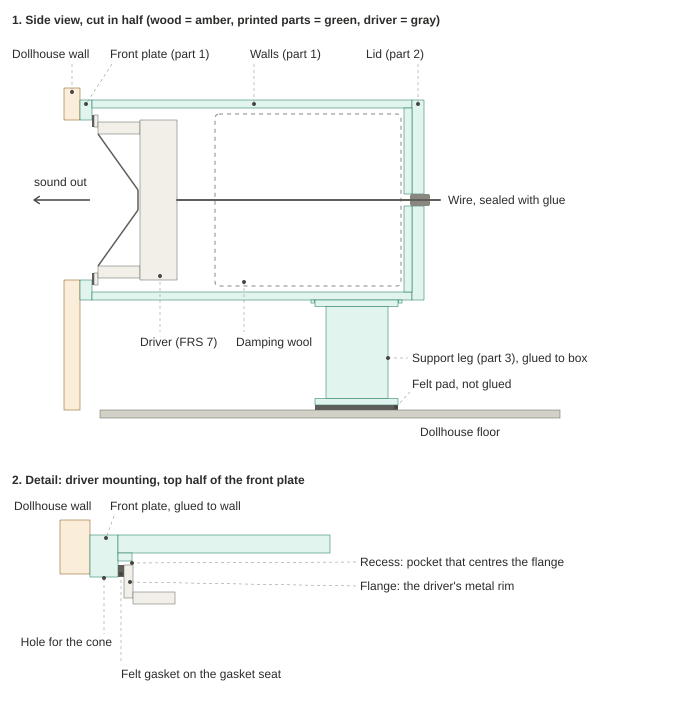
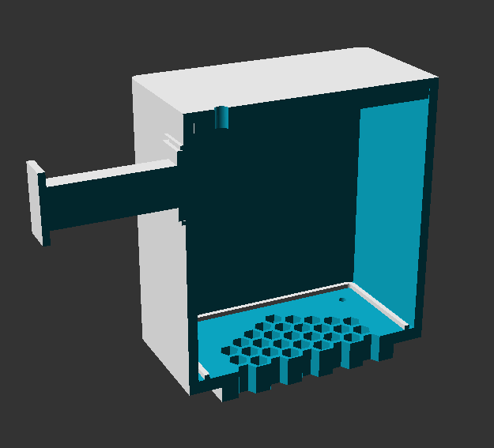
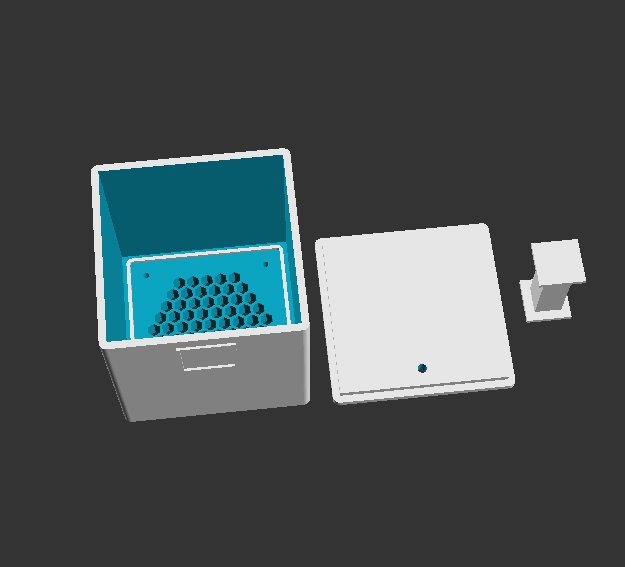

# Speaker box for the dollhouse windows (Visaton FRS 7, 8 ohm)

A small printed enclosure that sits behind a 60 x 60 mm window in the dollhouse wall (5 mm plywood). One box per window, so two boxes in total.

Terminology

- Flange: the flat metal rim around the driver, the part with the screw holes.
- Gasket: a soft strip that seals a joint. The flange on the FRS7 has already a gasket.
- Gasket seat: the flat surface the gasket presses against. Here it is the inside face of the front plate, in a ring around the hole. Keep it smooth and flat so the felt can seal.
- Recess: a shallow pocket. In the sketch it is a low raised rim (about 2 mm) around the flange. It keeps the driver centred and stops it from shifting sideways.

## Files

| File | What it is |
|---|---|
| `speaker_box_v4.scad` | Parametric OpenSCAD source of all parts. All dimensions are parameters at the top. |
| `speaker_box_v4.stl` | Print file: to be printed/imported in 3D printer software. |
| `speaker_box_sketch.svg` | Sketch: cross-section and close-up of the driver mounting. |
| `speaker_box_v4_cross_section.png` | OpenSCAD screenshot: assembled half cut away. |
| `speaker_box_v4_parts.png` | OpenSCAD screenshot: print layout (body, lid, leg). |

Per box, print one body, one lid and one leg. Re-export the STLs if you change any parameter.

## Design choices

**Sealed box, as large as the space allows.** The FRS 7 has a resonance of about 250 Hz and a Qts of about 1.2 to 1.3 (datasheet: 1.22 for 4 ohm, 1.28 for 8 ohm; Vas 0.3 L for 4 ohm). A driver that already has a Q above 1 only gets peakier in a sealed box, so no box volume makes the bass flat. The goal is the biggest volume that fits and a sealed box that stops front and back sound from cancelling. Inner volume is 0.40 L, about 0.31 L after the driver. My estimate is a total Q around 1.8 and a mild bump near 300 to 350 Hz. This is calculated from the 4 ohm Vas, so treat it as an estimate. A damping wool filling softens it.

**Size.** The box is 78 x 78 mm outside with 3 mm walls (72 x 72 mm inside) and 88 mm deep measured from the back of the wall, which leaves 2 mm under the 90 mm limit.

**Spigot.** The front plate has a square plug, 59.4 mm, that sits in the 60 mm window and ends 0.5 mm behind the wood surface. It centres the box when you glue it, and it adds glue area on the inside edges of the window. The plate around it gives a 9 mm glue ring on the back of the wall.

**Front plate with hexagonal grille.** The grille is a honeycomb of hexagonal holes, 5 mm across the flats with 2.5 mm between them, inside the 56 mm cone opening. It also hides the screws and the flange, so nothing shows through the window.

**Driver mounting.** The flange screw holes are inside the 60 mm window, so the driver is screwed from behind into four blind pilot holes in the plate (on the 75.5 mm circle at 45 degrees). A thin rim around a 67 mm square pocket holds the 66.5 mm flange in place; the driver's own felt is the gasket against the flat plate face.

**Two printed parts plus a leg.** The driver goes in through the open back, and a lid with a plug closes the box. The lid has a 4 mm wire hole low on the lid, sealed with glue or silicone. The body is printed with the grille face down, so the grille and the glued face need no extra work.

**Support leg.** The box hangs about 8 cm out from the wall and weighs about 0.3 kg, so a leg takes the weight to the floor. The gap from the box bottom to the floor is 42 mm (window bottom edge at 51 mm, box centred on the window). The leg is 40.5 mm tall, plus a 2 mm felt pad that gets squeezed by 0.5 mm. The leg is a separate part because a leg built into the wall would need supports. A 1 mm sloped frame on the bottom of the box locates the leg, so it can only be glued in the right place.

**Material.** PLA for the prototype, PETG for the final boxes. PLA creeps and softens above about 55 to 60 degrees, which a hanging box on a sunny or heated wall will see.

## Assembly

1. Solder the wire to the driver and thread it through the lid hole.
2. Glue the leg plate into the frame on the box (epoxy, thin layer).
3. Glue the box to the back of the wall around the window (two-part epoxy or MS polymer), with the spigot in the window.
4. Screw the driver in from the back (M3 self-tapping, check the length so the tips do not break through the front).
5. Add loose damping wool, close the lid with the plug, and seal the lid seam and the wire hole.
6. Put a self-adhesive felt or foam pad under the leg. Do not glue the foot to the floor.

Airtightness check: close the box and press the cone gently through the grille. It should spring back slowly. Hissing at a seam shows where to seal.

## Print settings (Bambu P1S, 0.4 mm nozzle, Bambu Studio)

Print each part in the orientation of the STL file. The body has the grille face on the bed and the open end up, the lid has the plate down and the plug up, and the leg stands on its foot plate.

| Setting | PLA prototype | PETG final |
|---|---|---|
| Profile | 0.20 mm Standard (0.28 mm Extra Draft is fine for a fit test) | 0.20 mm Standard |
| Plate | Textured PEI | Textured PEI (smooth PEI needs a glue stick as a release layer) |
| Nozzle / bed | Stock PLA profile, about 215 to 220 / 55 degrees C | Stock profile of your PETG, about 240 to 260 / 70 degrees C |
| Part cooling | Stock PLA (high). Open the door or remove the top glass if the chamber gets warm. | Reduced, about 30 to 50%. Keep the door closed. |
| Wall loops | 4 | 4 |
| Infill | 15% gyroid | 15 to 20% gyroid |
| Supports | Normal (auto), on build plate only, top Z distance 0.2 mm, 2 interface layers | Same, with top Z distance 0.25 to 0.3 mm because PETG fuses to supports |
| Brim | None | None |
| Filament | Any dry PLA | Dry the filament first (about 65 degrees C, 4 to 6 hours if it was stored open) |

Supports are needed only under the ring of the front plate around the spigot (4.5 mm tall). In the preview there should be nothing else. The underside of that ring is a glue face, so a rough surface does not matter; sand it flat on a table.

## Things to check on the prototype

- The spigot in the sawn window (`spigot_clear`), the flange in its pocket (`flange_clear`) and the leg in its frame (`leg_seat_clear`). PETG prints fit slightly tighter than PLA.
- The pilot hole (`screw_pilot_d`). It is 2.6 mm for PETG. PLA can split, so try 2.8 mm.
- The real gap from the box bottom to the floor (`window_bottom_height`), which assumes a flat floor and a box centred on the window.
- The depth inside the dollhouse (`depth`, max 90 mm).
- Airtightness of the walls and the lid seam, and the sound of the first box.
